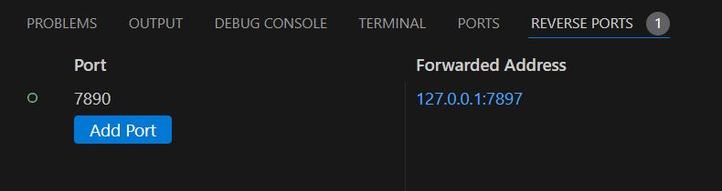

# Reverse Ports

让远程服务器用上你电脑里的代理和服务。

[项目网站](https://0use.net/reverse-ports/) · [安装扩展](https://marketplace.visualstudio.com/items?itemName=0use-TE.reverse-ports) · [下载 VSIX](https://github.com/0use-TE/reverse-ports/releases/latest) · [更新记录](CHANGELOG.md)

用 VS Code 连上服务器后，想让服务器走本机代理，或访问本机正在开发的接口？在底部的「反向端口」里加一条转发就行，不用另开终端挂着一串 SSH 命令。

比如，你电脑上的代理开在 `7897`，可以把它接到服务器的 `7890`：

```text
远程服务器 127.0.0.1:7890  →  SSH  →  你的电脑 127.0.0.1:7897
```



## 怎么用

1. 在**本机 VS Code** 安装 [Reverse Ports](https://marketplace.visualstudio.com/items?itemName=0use-TE.reverse-ports)。也可以下载 VSIX，运行「扩展：从 VSIX 安装」。
2. 用 Remote SSH 连上服务器，打开底部的「反向端口」。找不到这个标签页，就在命令面板搜索「反向端口：打开面板」。
3. 点击「转发端口」，填远程端口和本机地址，按 Enter。比如远程填 `7890`，本机填 `7897`；本机地址留空，就是两边用同一个端口。

圆点变绿就连上了。点圆点可以暂停或重新启动；双击端口或地址可以修改。行尾的 × 会停止转发并移除这条规则。

扩展会使用当前远程窗口的 SSH 主机。在本地窗口里，则默认使用 SSH 配置中的第一个主机。

## 让远程终端走代理

转发的是 HTTP 或混合代理时，右键这条规则，勾选「终端代理」。扩展会打开一个带代理变量的**新远程终端**，也可以直接点行内的终端图标。

之后创建的新终端也能继承代理设置。已经打开的终端需要重开；取消勾选不会改动已有终端。这个功能需要在对应的 Remote SSH 窗口中使用，并且已打开远程文件夹。

只想自己设置？点复制按钮，就能拿到三行 `export` 命令，粘贴到远程终端即可。代理地址用的是**远程端口**：上面的例子里是 `http://127.0.0.1:7890`。

这只给读取代理变量的程序设置代理，不会接管整台服务器的网络。

## 登录和连接

你原来的 SSH 密钥、Agent、config 和 ProxyJump 都可以继续用。需要密码或私钥口令时，会弹出隐藏输入框；密码不保存，取消输入就停止这次连接。

第一次连接新主机，先在本机终端运行一次 `ssh 你的主机别名`，核验并确认主机指纹。扩展用的是本机 OpenSSH，与 Remote SSH 的登录连接相互独立。

转发只监听服务器的 `127.0.0.1`，不会向公网开放端口，也不修改服务器上的文件和 SSH 配置。VS Code 重载后，需要手动重新启动转发。

如果没连上，把鼠标放在状态圆点上看原因，或运行「反向端口：日志」。先确认本机服务已启动、地址没填错，再检查 SSH 登录和远程端口是否被占用。

## 设置

通常不需要改。使用其他 SSH 程序或配置文件时，在本机用户设置中填写：

| 设置 | 用途 |
| --- | --- |
| `reversePorts.sshPath` | SSH 程序路径，默认是 `ssh` |
| `reversePorts.sshConfigFile` | 要使用的 SSH 配置文件路径 |

## 开发

```bash
npm ci
npm test
npm run package
```

打开源码目录按 F5 调试。更多测试方式见[开发说明](docs/development.md)，实测情况见[验证记录](TEST-RESULTS.md)。

MIT License · [反馈问题](https://github.com/0use-TE/reverse-ports/issues)
